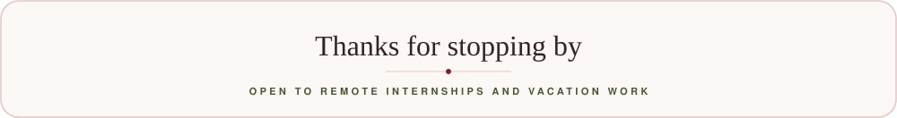

<!--
  The six SVG banners in ./assets cycle through four palettes on a 44 second loop,
  holding each one for about 9 seconds and melting into the next:

    1. Blush      dusty rose on blush paper
    2. Porcelain  mulberry on warm paper
    3. Champagne  rose gold on cream
    4. Lilac      soft mauve on pale lilac

  All four are light and soft. Nothing dark, nothing primary. If you ever want
  it to settle on one instead of cycling, say which and I'll freeze it.
-->

 

 

 

 

  

## 🌸 About me

I'm a **computer science** student in **Johannesburg**, majoring in computer science, computer applications and organisational psychology. The combination is deliberate. Most systems fail at the point where they meet the people meant to use them, and I want to be useful on both sides of that line.

- 🎓 **BSc Computer Science**, University of the Witwatersrand, majoring in computer science, computer applications and organisational psychology
- ☁️ Completed the **AWS Agentic AI Business Professional** nanodegree, selected for it through the **AWS AI & ML Scholars** programme
- 🔷 Four **SAP** certifications spanning business AI, autonomous enterprise concepts, technology consulting and business analysis
- 📋 **Google Project Management** certified, with a **Wharton** business foundations specialisation
- 📚 Tutoring mathematics, science and English since 2022, which is four years of making technical ideas land
- 🎯 Currently building toward **AWS Solutions Architect Associate**
- 📫 Best way to reach me: [email](mailto:gomolizandrea@gmail.com) or [LinkedIn](https://www.linkedin.com/in/gomolemo-b-a85159214)

## 🧰 Skills &amp; tools

## 🏅 Certifications

 

 

 

 

All ten verifiable on <a href="https://www.credly.com/users/gomolemo-baloyi">Credly</a>.

## 🌷 Projects

<table>
  <tr>
    <td width="50%" valign="top">
      <h3>🤖 Market Intelligence Agent</h3>
      
A no-code AI agent built in Amazon QuickSuite, using a Kaggle dataset as its knowledge base. Used Quick Research for market analysis, produced a leadership brief from the output, and evaluated the agent's reliability before relying on it.

      
  

    </td>
    <td width="50%" valign="top">
      <h3>📊 Revenue Intelligence Dashboard</h3>
      
A business intelligence project unifying CRM, marketing and support data into a single revenue view. Built on AWS with QuickSight and SPICE, delivered with build logs and a written executive report. Passed mentor review.

      
  

    </td>
  </tr>
  <tr>
    <td width="50%" valign="top">
      <h3>🍽️ Restaurant Order Tracking App</h3>
      
A university group build. I owned the MySQL database layer, designing the schema behind order state changes, and implemented user authentication in PHP, alongside contributing to the front-end styling.

      
  

    </td>
    <td width="50%" valign="top">
      <h3>🌐 Portfolio Website</h3>
      
A single-file, dependency-free site: responsive to mobile, keyboard accessible, reduced-motion aware, deployed on GitHub Pages.

      
  

      <a href="https://gomolemo001.github.io/portfolio"><b>Visit the site</b></a>
    </td>
  </tr>
</table>

## 📊 GitHub stats

<!--
  If these look thin, delete this section. They read live from your account,
  so they only flatter you once there are repositories with commit history.
-->

